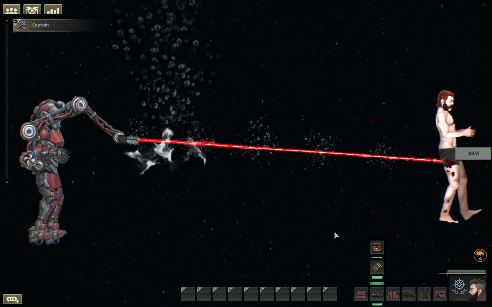
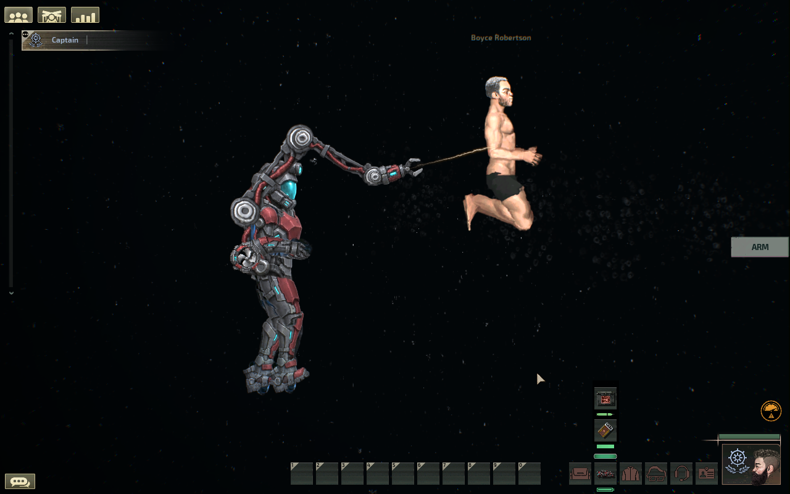

# Oryginalny laser pulsacyjny i promienie — 1.3.20

Tryb obronny ma teraz pomniejszoną oryginalną głowicę lasera pulsacyjnego z gry: szynę, lufę i oba panele. To bezpośrednie odwołania do `Content/Items/Weapons/Turrets.png`, w jednolitej skali 0,11, około 22% wielkości natywnej wieżyczki. Punkt wylotu uwzględnia oryginalny `firingoffset=-10,-220` i pokrywa się z rzeczywistym początkiem strzału.

Poprzedni efekt składał się z natywnej smugi oraz dodatkowych trzech linii GUI. Podczas ruchu te elementy rozjeżdżały się i tworzyły nakładające się kreski. Dodatkowa nakładka została usunięta. Strzał korzysta z oryginalnej czerwonej tekstury lasera pulsacyjnego, natywnego mieszania addytywnego oraz wygaszania.

Próba GPU wykryła także przyczynę przerwy między lufą a smugą: jednolite skalowanie emitera skracało również długość raycastu. Zarejestrowano wariant cząsteczki z tą samą teksturą `ParticleAtlas.png`, wycinek 144,440,1,68, zmniejszając tylko grubość Y i jej tempo zanikania. Skala emitera pozostaje 1, a pełną długość X ustala silnik. Rozbłyski u wylotu i na trafieniu są mniejsze i mniej liczne.

Chwytak oraz naprawa używają miękkiej, neutralnej tekstury z natywnego atlasu cząsteczek, z pomarańczową lub niebieską poświatą i cienkim jasnym rdzeniem. Zastępuje to trzy grube prostokątne pasy. Iskry naprawy pozostają w miejscu pracy.

Nie dodano nowych bitmap ani nie przemalowano oryginalnych zasobów gry. Mod wskazuje ich ścieżki; nie dołącza natywnych atlasów do paczki.

## Weryfikacja

- **597 testów automatycznych** i walidacja **18 XML / 59 modułów Lua 5.2**. Regresje obejmują brak dodatkowej czerwonej nakładki, oryginalną lufę również w spoczynku, połączenie wylotu, miękki promień chwytaka, zwolnienie zasobów przy przeładowaniu i zachowanie pełnej długości smugi.
- **3/3 prób natywnego klienta GPU**, z włączonym oświetleniem: strzelanie, chwyt żywej postaci i naprawa z iskrami. Wyemitowano 5 strzałów; skrzynka spadła 100 → 88,75. Rzeczywisty `Particle.Size.X` wyniósł około 396 jednostek, zgodnie z dystansem od wylotu do celu. [Log](aegis-suit/beam-native-checks.txt).
- **10/10 etapów na oddzielnym serwerze i rzeczywiście dołączonym kliencie**. Klient zaobserwował nowy wariant natywnej smugi. Serwer potwierdził 4 strzały oraz błąd początku emisji poniżej 0,005 jednostki. Sprawdzono też chwyt, sonar, naprawę z przyrostem umiejętności i spawanie. [Serwer](aegis-suit/beam-mp-server.txt), [klient](aegis-suit/beam-mp-client.txt), [zrzut z dołączonego klienta](aegis-suit/beam-mp-native-pulse.png).
- Niezależny przegląd sprawdził ułożenie czterech oryginalnych części broni, zwalnianie sprite’ów oraz wariant cząsteczki zmniejszony wyłącznie w osi Y.

Zrzuty pochodzą z natywnego renderera, bez obróbki obrazów. W próbie chwytu ciało chwilowo odsunięto, aby pokazać promień podczas odzyskiwania pozycji przez kontroler.

[Naprawa i iskry](aegis-suit/beam-soft-repair.png).

Po aktualizacji uruchom ponownie grę oraz serwer, aby wczytać nową definicję cząsteczki. Protokół kombinezonu pozostaje v5. [Paczka 1.3.20](../output/System-Aegis-1.3.20-aegis-beams-2026-11-17.zip). Poprzednie paczki zachowano.
