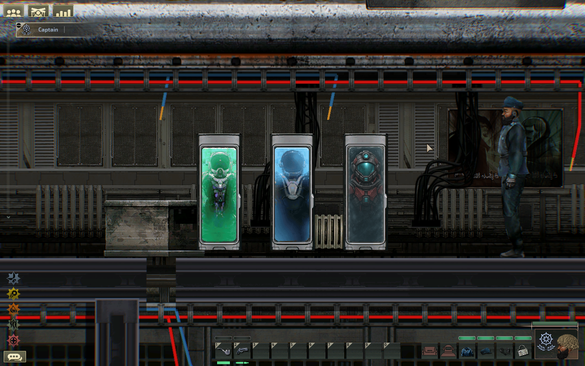

# Grafika kombinezonu w szafce — 1.3.19

Poprzedni sprite przedstawiał cały kombinezon bokiem, łącznie z nogami i butami. W szafce wyglądał jak pomniejszona stojąca postać. To nie odpowiadało sposobowi prezentacji kombinezonów za szybą w podstawowej grze.

Porównanie oparto na rzeczywistym `Content/Items/Diving/divinggear.xml` i atlasie `Content/Items/Containers/containers.png` z Barotrauma1.13.5.0:

| Element | Natywna szafka z szybą | Poprawiony Aegis |
|---|---|---|
| Kierunek | Hełm i tors przodem do kamery | Przodem |
| Kompozycja | Duży hełm, ramiona i fragment torsu | Duży hełm, ramiona obcięte krawędziami szyby |
| Dół | Pancerz zanika w ciemnym szkle | Zanikający tors, bez nóg i butów |
| Szkło | Przyciemnione, z przetarciami | Przyciemnione, z przetarciami |
| Rozmiar wkładu | Zwykły kombinezon77×209 przy skali0,5 | 657×1742 przy skali0,06, czyli prawie identyczny rozmiar w świecie |

Szafki z szybą używają osobnej nowej [tekstury](../System-Aegis/Assets/AegisSuit/rack-window-v2.png). Stojaki oznaczone `divingsuitcontainervertical` mają oddzielny wycinek sylwetki, bez dolnych części nóg i butów, zgodnie z rozdzieleniem sprite’ów w natywnym XML. Złożony przedmiot zachowuje własną grafikę.

Nowy PNG został wygenerowany wbudowanym `image_gen` z poprzednim kombinezonem jako celem edycji i natywnym atlasem jako wzorcem kompozycji. Oryginalny raster762×2063 RGBA skopiowano bez zmian. XML pomija marginesy i nadmiar dolnego pustego szkła; nie przeskalowuje ani nie przemalowuje pliku. [Specyfikacja i prompt](aegis-suit/rack-window-v2-prompt.txt).

Porównanie w grze: po lewej zwykły kombinezon, w środku głębinowy, po prawej Aegis. Wszystkie umieszczono w jednakowych szafkach `divingsuitlocker`, w jednej scenie i tej samej skali kamery. W tej odrębnej scenie testowej wyłączono oświetlenie i zasłanianie widoku, aby jednakowo pokazać trzy tekstury; ustawienia przywrócono po zrzucie. Usunięto meble zasłaniające szafki. Zrzut pochodzi z natywnego renderera, bez obróbki rastra.

Zmiana obejmuje zasoby i wybór sprite’a. Wyniki funkcjonalne i pomiary wydajności poprzedniej wersji pozostają opisane osobno w [raporcie1.3.18](AEGIS-SERVICE.md).
