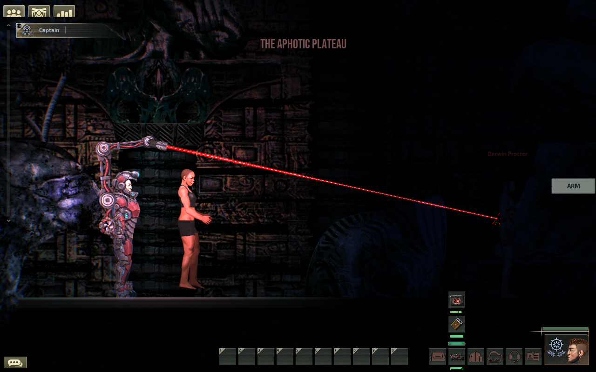
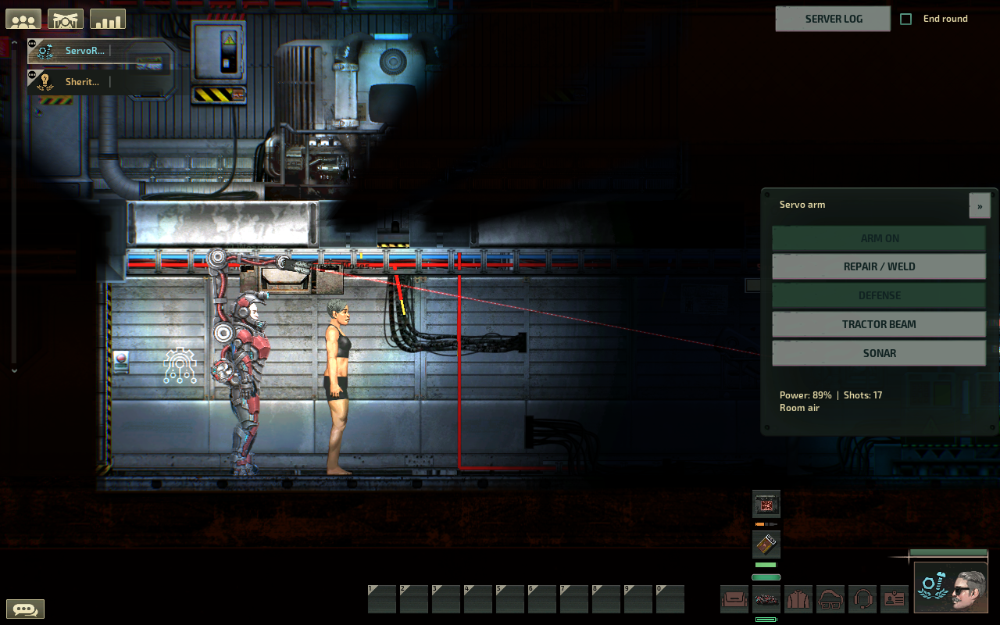

# Strzelanie nad sojusznikami i przeszkodami — 1.3.21

Na lądzie tryb obronny próbuje unieść lufę, gdy zwykłą drogę do przeciwnika zasłania sojusznik lub niska przeszkoda. Ramię płynnie ustawia przeguby i rozpoczyna strzelanie po osiągnięciu bezpiecznej pozycji. Przy wolnej drodze zachowuje zwykłe celowanie. Funkcja nie wymaga dodatkowego przycisku.

Sprawdzane są oba możliwe zgięcia przegubów i sześć pozycji nad mocowaniem, w dotychczasowym promieniu ruchu 118 jednostek. Najniższy wariant pozwala wykorzystać prześwit w zwykłej kabinie. Każdy odcinek ramienia i lufy musi omijać ściany oraz postacie; wylot musi mieć wolny promień do przeciwnika. Dotyczy to także sojusznika stojącego tak blisko, że zwykła lufa znalazłaby się już po jego drugiej stronie.

Jeśli brakuje miejsca pod sufitem albo przeszkoda jest zbyt wysoka, kombinezon wstrzymuje ogień. Nie zwiększa długości ramienia, zasięgu strzału ani obrażeń. Nie steruje ruchem i kucaniem użytkownika. Pod wodą zachowuje poprzednią kontrolę ścian od mocowania do wylotu i nie wyszukuje pozycji nad przeszkodą.

Plan jest przechowywany do 0,12 s, z wcześniejszym ponowieniem po większym ruchu użytkownika lub celu. Po usunięciu przeszkody ramię czeka co najmniej 0,5 s stabilnego prześwitu przed powrotem do zwykłej pozycji. Przy każdym rzeczywistym strzale ponownie sprawdza bieżącą drogę, również w opóźnionym wywołaniu tworzącym pocisk. Wejście sojusznika przed lufę blokuje strzał bez oczekiwania na nowe planowanie.

## Weryfikacja — 18 listopada 2026

- **612 testów automatycznych** oraz walidacja **18 XML / 60 modułów Lua 5.2**. Nowe regresje obejmują bliskiego i dalszego sojusznika, pojawienie się przeszkody między obliczeniami, przejście ramienia przez postać, niską ścianę, różne wysokości sufitu, blokadę pełnej ściany, płynne ustawienie, powrót do zwykłej pozycji, pamięć względnej pozycji i zachowanie pod wodą.
- **7/7 prób natywnego klienta GPU**: sucha pozycja, zwykłe strzelanie, strzały ponad stojącym sojusznikiem bez utraty jego zdrowia, opuszczenie po odejściu NPC, rzeczywista niska ściana, pełna ściana i niski sufit. Ostatnie dwa przypadki nie zużyły amunicji. [Log próby](descendant-suit/raised-aim-native.txt).
- **4/4 etapów prywatnego serwera z rzeczywiście dołączonym klientem**, w istniejącej kabinie Azymutu 976 × 288, z zachowaniem jej podłogi i sufitu: zwykły strzał, uniesienie ponad NPC, opuszczenie i ponowne uniesienie. Serwer zarejestrował po 6 strzałów na etap. Sojusznik zachował 100 zdrowia. Klient otrzymał aktualne migawki v5 i pozycję lufy około 65 jednostek nad mocowaniem w etapach uniesienia. [Serwer](descendant-suit/raised-aim-mp-server.txt), [klient](descendant-suit/raised-aim-mp-client.txt).
- Niezależny przegląd wykrył przypadek sojusznika przed wysuniętą lufą oraz zmianę kontroli ściany pod wodą. Oba poprawiono po odtworzeniu w testach, następnie powtórzono pełną regresję i próby natywne.

To próby funkcjonalne na Barotrauma 1.13.5.0 / LuaCs c6e8829. Nie powtarzano długiego pomiaru FPS wielu kombinezonów. [Poprzedni pomiar wydajności](DESCENDANT-PERFORMANCE.md) nadal opisuje ograniczenia wielu jednoczesnych napraw. Testy korzystają wyłącznie z odizolowanych kopii gry; przygotowanie pomieszczeń jest częścią skryptów testowych, nie moda.

Poniższe zrzuty pochodzą bezpośrednio z renderera gry, bez obróbki obrazów.

[Strzał ponad rzeczywistą niską ścianą](descendant-suit/raised-aim-over-wall.png).

Po aktualizacji uruchom ponownie klienta oraz serwer. Obie strony wymagają wersji 1.3.21; protokół kombinezonu pozostaje v5. [Paczka 1.3.21](../output/MULTI-TOOL-V2-1.3.21-descendant-raised-aim-2026-11-18.zip). Starsze paczki zachowano.

Paczka ma 129 plików, 28 519 288 bajtów; SHA256: `c73ae381966512970eed27ca34803f510ccf52ee28504ef8bed10b943eb13eaa`. Zawartość porównano bajt po bajcie ze źródłem i obiema przetestowanymi kopiami natywnymi.
